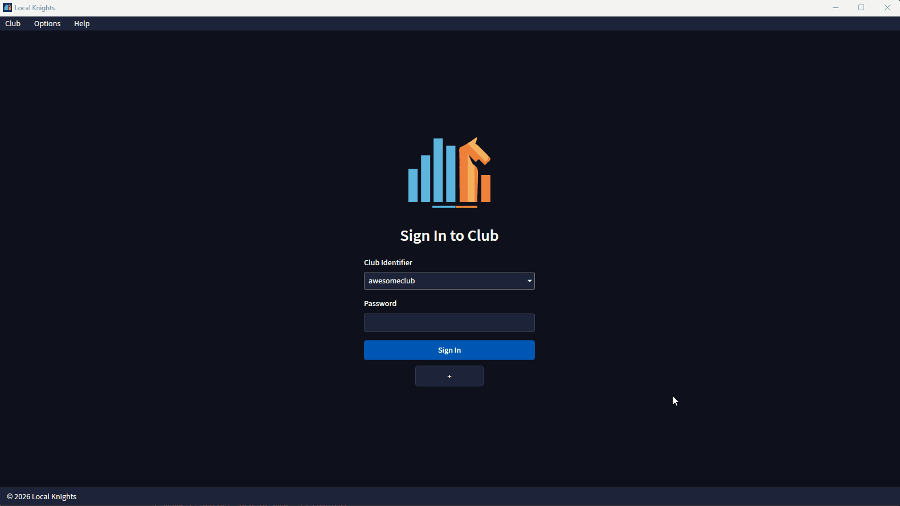

# Local Knights

[](LICENSE)
[](https://github.com/urbanoanderson/local-knights/releases)


<p align="center">
	
</p>

<p align="center"><strong>The open source community chess club management software.</strong></p>

<p align="center">
	Local Knights is a modern desktop app for running chess clubs. Manage players, record games, organize competitions, generate pairings, and maintain internal club ratings from one polished interface.
</p>

## Why Local Knights ♟️

- Completely free and open source under the MPL-2.0 license. No subscriptions, no ads
- Fully local desktop experience with no cloud dependency. Clean navigation, responsive layouts, dark and light themes, and multilingual support
- Club data stored in a single password-protected database file. Simple to backup and restore everything
- Perfect for community chess clubs, friend groups and school programs that need something more structured than spreadsheets and want a free and open source workflow

## Core Capabilities 🚀

### Manage club members 👥

- Register players and maintain complete profiles for club members
- Link player profiles to [Chess.com](https://www.chess.com/), [Lichess](https://lichess.org/), [FIDE](https://www.fide.com/) and other chess organizations
- Manually input or fetch ratings from supported external platforms during player creation
- Maintain separate member ratings across different time formats (Bullet, Blitz, Rapid and Classical)

### Organize Competitive Play 🏆

- Support for both [Glicko-2](https://en.wikipedia.org/wiki/Glicko_rating_system#Glicko-2_algorithm) and [Elo](https://en.wikipedia.org/wiki/Elo_rating_system) rating systems. Update ratings as games and tournament results are recorded
- Record individual Games (rated or unrated) and even store [PNG](https://en.wikipedia.org/wiki/Portable_Game_Notation) notations for them if needed.
- Organize [Swiss](https://en.wikipedia.org/wiki/Swiss-system_tournament), [Round-Robin](https://en.wikipedia.org/wiki/Round-robin_tournament), [Knockout](https://en.wikipedia.org/wiki/Single-elimination_tournament) and two-player Match competitions. Tracking rounds, pairings, standings and results in one place
- Generate swiss pairings using FIDE-approved pairing logic via [Chesspairing](https://github.com/gnutterts/chesspairing/) library

### Modern Desktop App Experience 💻

- Built using modern technologies with responsive screens that remain usable across different window sizes
-  Made for practical daily use with straightforward navigation focused on players, games, competitions and club settings
- Light and dark themes for different environments and preferences
- Localization support for different languages

### Built For Local Ownership 🔒

Unlike web-first club tools, Local Knights is designed around local-first control.

- Your club database lives on your own machine. No hosted backend needed
- Backup is as straightforward as copying one encrypted `.db` file
- Restore is simple, portable, and independent of third-party infrastructure

## Getting Started ▶️

Getting a club up and running is intentionally simple.

1. Download latest version of the app from our [releases](https://github.com/urbanoanderson/local-knights/releases) page as a zip file.
1. Extract the zip contents into any desired folder. Optionally create a shortcut to the "Local Knights.exe" executable.
1. Launch the app via "Local Knights.exe".
1. On first launch, click on the "+" button and configure your club's name, rating preferences, password, etc.
1. Login to your club using the created password and access the club dashboard.
1. Register players individually via Create button on Players page. Alternatively, bulk import of player files in CSV format is supported ([sample import file](Scripts/Seed/player-bulk-import-sample.csv)).
1. Create Games and Competitions featuring the registered players via the respective pages and creation forms.
1. Enjoy and keep chess alive in your community! Club data will be stored at "C:\Users\<USERNAME>\AppData\Local\LocalKnights\Clubs".



## Privacy & Data Handling ⚠️

This application is designed with privacy in mind:

- **Local Storage Only**
  All club data (players, games, competitions) is stored locally on the user’s computer in an SQLite database. The application does not transmit, sync, or share data with external servers or third parties.

- **No Data Collection by the Developer**
  The developer of this software does not collect, access, or process any personal information entered into the application.

- **Responsibility of Club Owners**
  Club owners and administrators using this software are responsible for ensuring compliance with applicable data protection laws, including the EU General Data Protection Regulation (GDPR) and Brazil’s Lei Geral de Proteção de Dados (LGPD). This includes informing players about how their data is used, obtaining consent where required, and respecting rights to access, correction, and deletion.

- **Security Recommendations**
  - Protect access to your computer and database files.
  - Regularly back up your data securely.
  - Consider creating strong passwords for protecting real club's databases. Passwords are not backed up by Local Knights or Third Party services. Password management software use is recommended to avoid losing access to club data.

**Disclaimer:** This software is provided “as is.” While it facilitates local data management, ultimate responsibility for lawful and compliant use of personal data rests with the club owners and administrators.

## Developer Information 🛠️

### Technologies used ⚙️

- .NET 10 Desktop application built with WPF and MVVM pattern
- SQLite storage with SQLCipher for password-protection
- [Chesspairing](https://github.com/gnutterts/chesspairing/) library for generating pairings according to FIDE rules

### Versioning 🔢

- Local Knights uses the version format `MAJOR.MINOR.REVISION`
- Stable releases based on `main` branch. Experimental pre-releases based on `dev` branch
- CI/CD workflows automatically build, test, create artifacts and generate pre-releases and releases

### Build, Test and Run from Source 🧪

.NET 10 SDK is required

```bash
dotnet restore

dotnet build ProjectSolution.slnx

dotnet test ProjectSolution.slnx

dotnet run --project LocalKnights.WindowsDesktop/LocalKnights.WindowsDesktop.csproj
```

## License 📄

Local Knights is licensed under the Mozilla Public License 2.0.

See [LICENSE](LICENSE) for the full license text.

For third-party components, bundled libraries, and external implementation references, see [THIRD-PARTY-NOTICES.md](THIRD-PARTY-NOTICES.md).
