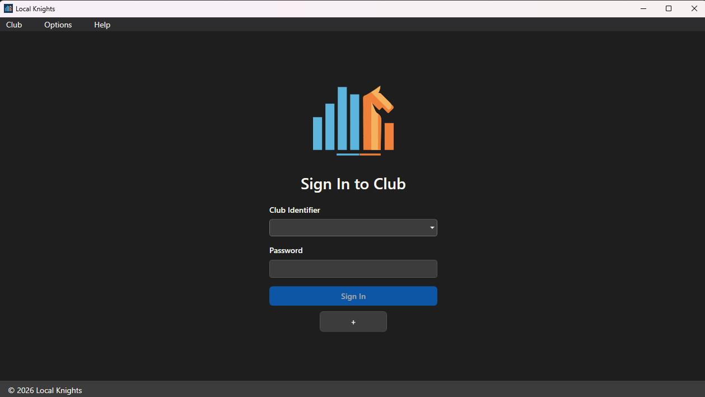
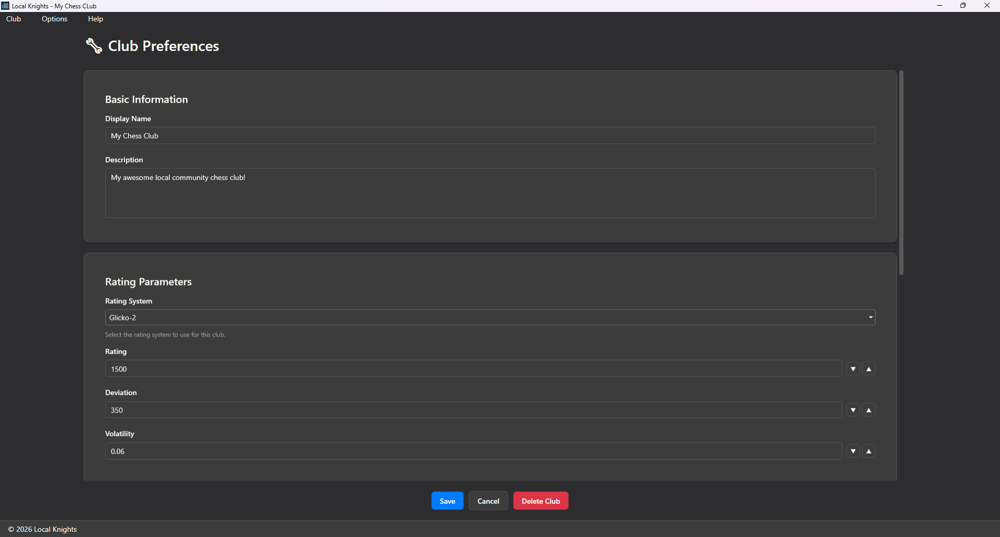
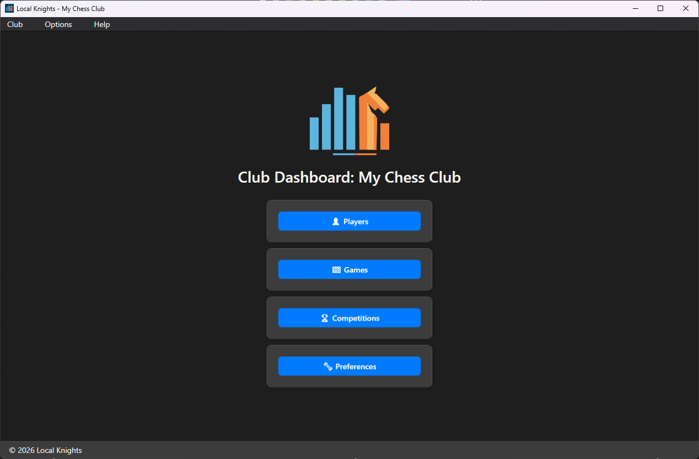
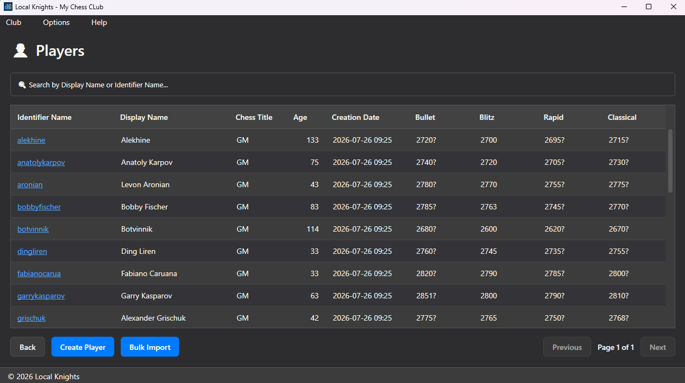
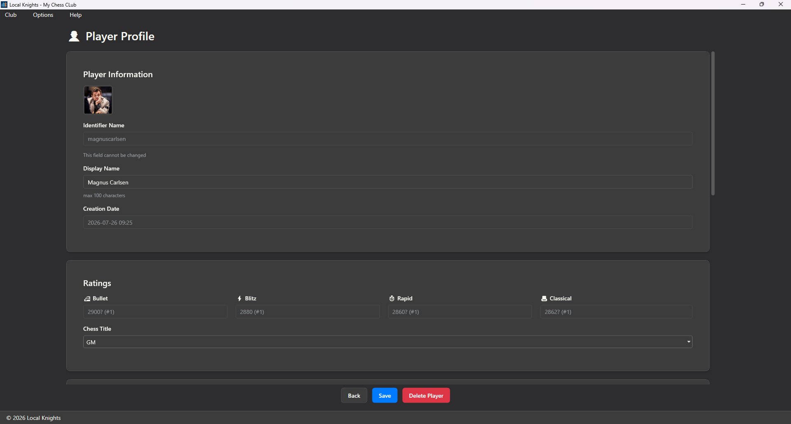
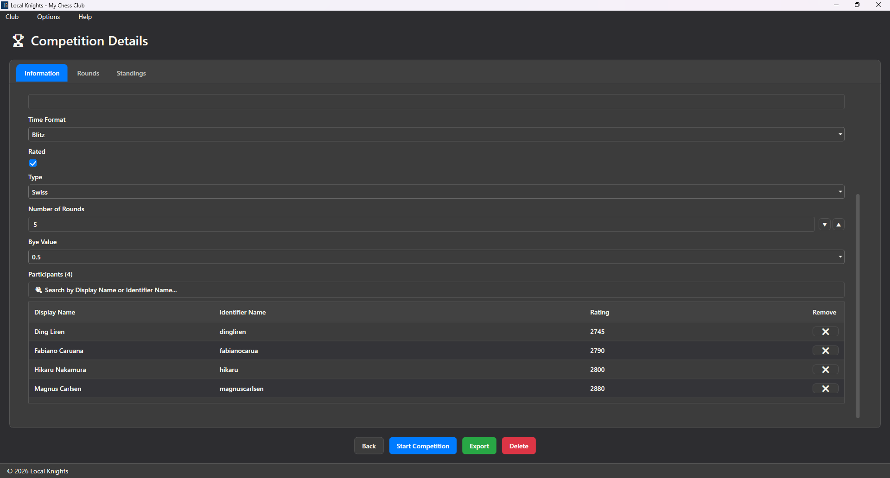
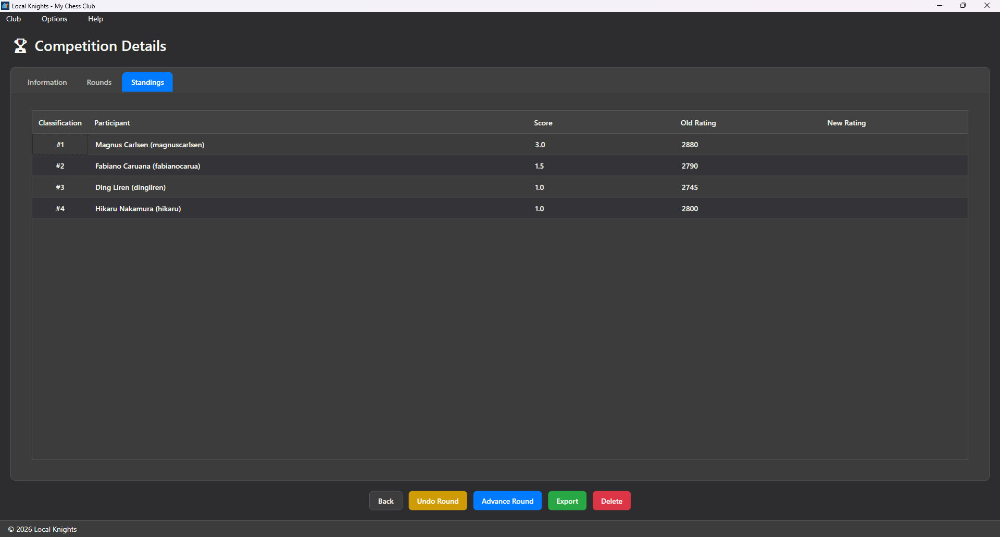
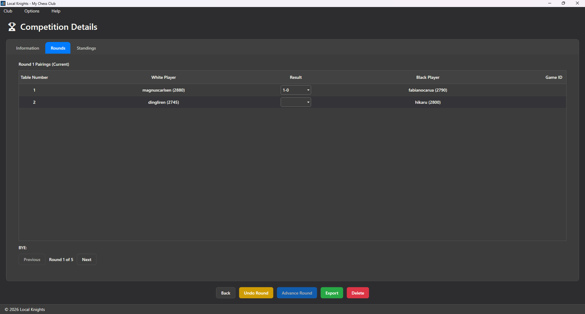

# Local Knights

[](LICENSE)
[](https://github.com/urbanoanderson/local-knights/releases)


<p align="center">
	
</p>

<p align="center"><strong>The open source community chess club management software.</strong></p>

<p align="center">
	Local Knights is a modern Windows desktop app for running chess clubs without subscriptions, server maintenance, or cloud lock-in.
	Manage players, record games, organize competitions, generate pairings, and maintain club ratings from one polished interface.
</p>

## Why Local Knights

Local Knights is built for clubs that want professional-grade organization software while keeping full control of their own data. Everything runs locally on the club owner's computer, so there is no need for external servers, complicated deployment, or recurring platform fees.

- Completely free and open source under the MPL-2.0 license
- Fully local desktop experience with no mandatory cloud dependency
- Club data stored in a single encrypted SQLite database file using SQLCipher
- Simple backup and restore workflow with no server setup required
- Clean navigation, responsive layouts, dark and light themes, and multilingual support

## What You Can Do

### Run Your Club Day To Day

- Register players and maintain complete club profiles
- Record individual games and automatically track rating changes
- Manage competitions from creation to final standings and exporting
- Keep historical data organized in a single local database

### Organize Competitive Play

- Generate pairings for Swiss tournaments using FIDE-approved pairing logic
- Run Round-Robin events, including support for round scheduling
- Organize Knockout tournaments and two-player Match competitions
- Track rounds, pairings, standings, and results in one place

### Maintain Meaningful Ratings

- Support for both Glicko-2 and Elo rating systems
- Maintain internal club ratings across different time formats
- Update ratings as games and tournament results are recorded

### Connect External Chess Profiles

- Link player profiles to Chess.com, Lichess, FIDE, USCF and other organizations
- Fetch ratings from supported external platforms during player creation
- Keep club data aligned with the broader chess ecosystem

## Built For Local Ownership

Unlike web-first club tools, Local Knights is designed around local-first control.

- Your club database lives on your own machine
- No hosted backend is required to operate the software
- Backup is as straightforward as copying one encrypted `.db` file
- Restore is simple, portable, and independent of third-party infrastructure

This makes Local Knights especially attractive for community clubs, schools, and organizers who want dependable software without operational overhead.

## Interface Highlights

- Modern Windows desktop experience built for practical daily use
- Light and dark themes for different environments and preferences
- Responsive screens that remain usable across different window sizes
- Straightforward navigation focused on players, games, competitions, and club settings
- Localization support currently available in English and Brazilian Portuguese

## Getting Started For Club Owners

Getting a club up and running is intentionally simple.

1. Launch Local Knights and create or open your club database.
2. Configure your club preferences, rating system, language, and visual theme.
3. Register players manually or enrich their profiles with Chess.com, Lichess, FIDE, or USCF data.
4. Start recording games or create a competition and let the app manage pairings, rounds, and standings.

Because the database is stored locally as a single encrypted SQLCipher-backed SQLite file, your operational workflow stays straightforward: create, use, back up, and restore without maintaining any server infrastructure.

### First Launch



### Club Preferences and Dashboard





### Players Management





### Competition Overview



### Standings and Rounds





## Technology

- Windows desktop application built with WPF and MVVM
- .NET 10
- SQLite storage encrypted with SQLCipher
- Local-first architecture designed for easy operation and maintenance

## Requirements

- Windows 10 or later
- .NET 10.0 SDK or later to build from source

## Build From Source

```bash
dotnet restore
dotnet build ProjectSolution.slnx
```

## Run

```bash
dotnet run --project LocalKnights.WindowsDesktop/LocalKnights.WindowsDesktop.csproj
```

## Test

```bash
dotnet test ProjectSolution.slnx
```

## Versioning

Local Knights uses the version format `MAJOR.MINOR.REVISION`.

## License

Local Knights is licensed under the Mozilla Public License 2.0.

See [LICENSE](LICENSE) for the full license text.

For third-party components, bundled libraries, and external implementation references, see [THIRD-PARTY-NOTICES.md](THIRD-PARTY-NOTICES.md).
